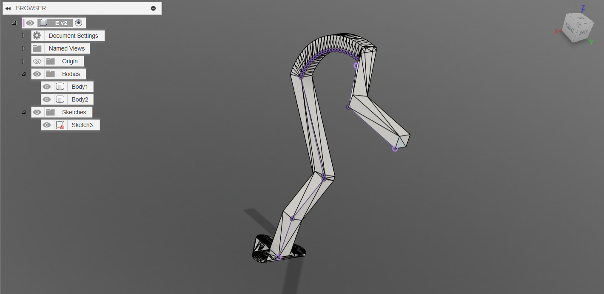
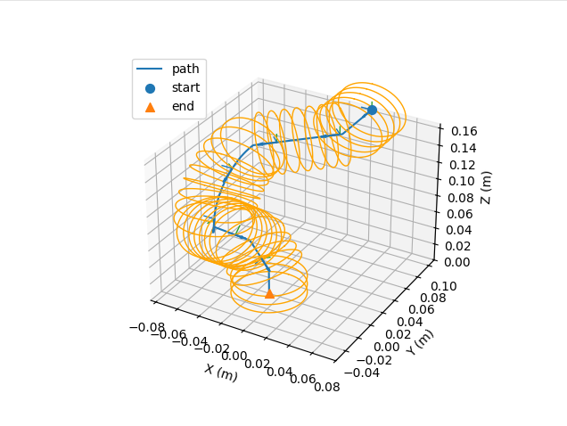

# Waypoints generation

This set of programs lets you generate waypoints for movement along a path from a .dxf file.

## Installation

You’ll need Python 3.9+ and the following libraries. Use the package manager [pip](https://pip.pypa.io/en/stable/) to install

```bash
pip install ezdxf numpy matplotlib
```

The ezdxf lib is for reading CAD/DXF geometry.

## Usage

I recommand using Fusion360 for the dxf generation. You will need to create a Mesh body, then convert it to Solid and use Sketch -> Project -> Include 3D Geometry tool to extract the edges of the maze you want to follow. Then export this sketch as .dxf.


Move .dxf to this dir and change DXF_FILE to yours path. 
```python
DXF_FILE = "E_path.dxf"        # your DXF
```
Then its simply
```bash
python waypoints_from_dxf.py
```
for generating .json with the waypoints and
```bash
python plot_XYZPRZ.py
```
for vizualization of the waypoints with the hoop vizualization included.

If you want just the waypoints without ring orentation for per partes debugging, use
```bash
python plot_waypoints.py
```

## Contributing

Pull requests are welcome. For major changes, please open an issue first
to discuss what you would like to change.


